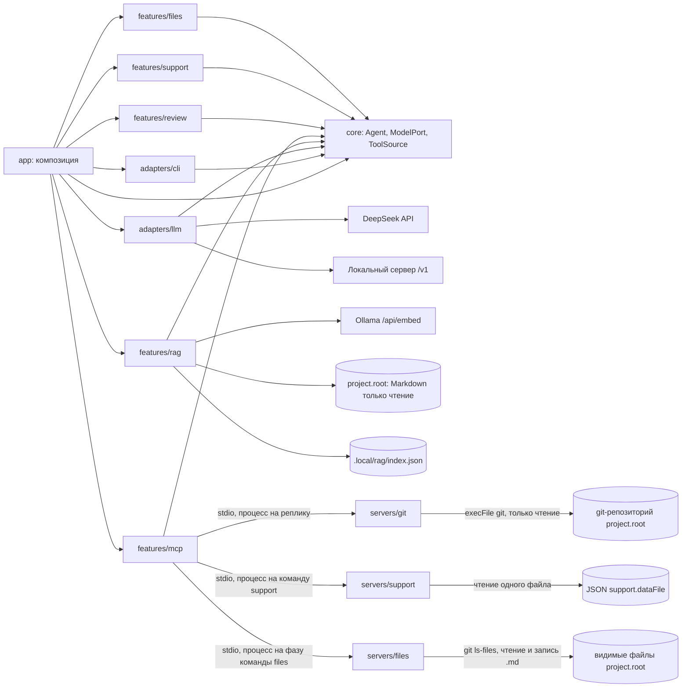

# Архитектура

## Текущее приложение

Исполняемый workspace `apps/host` и MCP-серверы `servers/git`, `servers/support` и `servers/files` — отдельные workspace и процессы.
Общих библиотек нет. `app/main.ts` принимает окружение, argv и потоки; `app/compose.ts` собирает приложение. Модель
(DeepSeek или локальная по `llm.provider`) создаётся лениво при первом `ask`, `rag ask`, `info <вопрос>`,
`review <база>`, `support <тикет> <вопрос...>` или `files <цель...>`, поэтому справка, настройки и `rag index` работают без ключа.

CLI получает реестр обработчиков и потоки, не создаёт агента и не знает SDK. Вывод оформляет один CliView: обработчики
передают ему готовые строки, цвет решает `styleText` отдельно для stdout и stderr. Ход длинной операции (`rag index`) идёт
в stderr. Текст из REPL становится вызовом `ask`; `/команда` и подкоманда CLI используют один dispatch.

## Agent и цикл инструментов

Agent инкапсулирует ModelPort, системную инструкцию и лимит вызовов и не хранит состояния: `respond(input, { tools, history })`.
Сообщения собираются как system → история → вопрос. Если `tools` объявил инструменты, модель получает их с
`toolChoice: auto`, пока не исчерпан `maxToolCalls`; ответ с tool_calls проверяется целиком (непустой, в пределах
лимита, известные имена, аргументы-объекты) и исполняется по порядку — параллельные вызовы делили бы один stdio-транспорт.
ChatCompletionsModel переводит формат SDK и ошибки в AgentError, SDK-повторы отключены. В ядре нет SDK, файлов, env и
пользовательских текстов.

Понятия из курса ложатся на каркас так: инструмент (`name`, `description`, `parameters`) — `ToolDefinition` с
`inputSchema`; реестр и исполнитель — `ToolSource` и `combineToolSources`, которые направляют вызов по имени; ошибка
«unknown tool» — `AgentError UNKNOWN_TOOL_CALL` до исполнения.

## ask, info и MCP-сессии

`createAskHandler` (app/ask.ts) на каждую реплику создаёт модель, затем `withSessions` по очереди открывает сессии серверов
из `RunOptions.mcpServers` (по умолчанию — git-сервер с `--root <project.root>`, `app/serverEntrypoints.ts`) — вложенно, поэтому каждая закрывается в `finally` своей обёртки в обратном порядке. Источники
оборачиваются `observedToolSource` (строка `MCP: сервер › инструмент — выполнено/ошибка`) и объединяются
`combineToolSources`; одинаковые имена инструментов у двух серверов — ошибка. Без серверов `ask` отвечает без инструментов.

`info <вопрос>` (app/info.ts, ADR 0002) сначала проверяет параметры поиска, создаёт модель и открывает индекс, затем
открывает те же MCP-сессии и вызывает `answerWithRag` с `tools`: rewrite → поиск → отбор → ответ модели по фрагментам
с инструментами (`prompts/project.md`, до `INFO_MAX_TOOL_CALLS` вызовов). Пустой отбор не отменяет вызов модели — ответ
может дать инструмент. Разбор принимает раздел «Данные проекта» и сверяет его строки с реально вызванными инструментами.

`withStdioToolSource` (features/mcp) запускает сервер, договаривается о современной ревизии протокола, проверяет
capability tools и адаптирует клиент к ToolSource; принимаются только текстовые блоки результата. Дочерний процесс
получает безопасный набор переменных SDK и объявленные `env`, но не окружение host.

## review и AI-ревью в CI

`review <база>` (app/review.ts, ADR 0003) проверяет параметры поиска, создаёт модель и открывает индекс, затем
открывает те же MCP-сессии, но инструменты вызывает сам host, а не модель:

1. `git_changed_files { base }` — изменённые файлы относительно merge-base; текст разбирается по контракту из README
   сервера. Без изменений ревью завершается без вызова модели.
2. По каждому файлу, в пределах `MAX_REVIEW_FILES` и `MAX_REVIEW_CONTEXT_CHARS`, — `git_diff { base, path }` и, если
   файл не удалён, `read_file { path }`. Не поместившиеся файлы перечисляются в ревью.
3. `searchQueries` (features/rag) — поиск по запросу на файл (путь и начало diff), объединение, порог и `rag.topK`.
4. `reviewChanges` (features/review) — один вызов модели без инструментов с `prompts/review.md`; разделы ответа
   проверяются по заголовкам. `renderReview` собирает итоговый Markdown с разделом «Контекст ревью».
5. Markdown печатается через CliView и, если задан `review.outputFile`, пишется в файл через временный файл и `rename`.

Workflow `.github/workflows/ai-review.yml` на событие `pull_request` запускает Ollama из Docker-образа, строит индекс, вызывает `review "origin/<base>"` и публикует файл одним комментарием PR с маркером
`<!-- ai-review -->`: существующий комментарий обновляется. Тот же текст уходит в Job Summary. PR из форков
пропускаются: секретов у них нет.

## support и ассистент поддержки

`support <тикет> <вопрос...>` (app/support.ts, ADR 0004) повторяет схему `review` для другого сервера: проверяет
параметры поиска, создаёт модель и открывает индекс, затем открывает сессию только сервера поддержки
(`--data <project.root>/<support.dataFile>`); в `ask`, `info` и `review` его нет.

1. `get_ticket { id }` — тикет, клиент и переписка текстом; host текст не разбирает. Ошибка — `InputError` текстом
   сервера, модель не вызывается.
2. `searchQueries` — два запроса: вопрос клиента и начало текста тикета (`SUPPORT_QUERY_CHARS`); порог и `rag.topK`.
   Пустой отбор не отменяет вызов.
3. `answerSupport` (features/support) — один вызов модели без инструментов с `prompts/support.md` без `app/system.md`;
   проверяются разделы «Ответ», «Источники», «Данные тикета» и номера `[N]` в «Источниках». `renderSupport` собирает
   Markdown с «Контекстом ответа», CliView печатает его блоком «Ответ поддержки».

Демо-продукт с документацией, тикетами и конфигом — `examples/support-product/`, индекс — `.local/rag-support`.

## files и правки с подтверждением

`files <цель...>` (app/files.ts, ADR 0005) — единственная команда с записью. Модель только предлагает правки, файлы
меняет host после ответа человека; фазы — отдельные вызовы, модель на этапе подтверждения не работает.

1. Фаза plan. Модель создаётся до серверов, затем открываются сессии files-сервера и серверов из
   `RunOptions.mcpServers` (git). `Agent` с `prompts/files.md` и лимитом `FILES_MAX_TOOL_CALLS` (15) получает
   `files_search`, `files_read`, инструменты git-сервера кроме `read_file` (HEAD путал бы с рабочей копией) и локальный
   `propose_edit`; `files_write` скрыт `withoutTools`. `propose_edit` (features/files) проверяет, что `old` встречается
   в файле ровно один раз, и копит правки в памяти; ошибка возвращается модели результатом `isError`.
2. Печать. `renderFilesResult` добавляет к ответу unified diff по каждому файлу (библиотека `diff`).
3. Подтверждение. `[y/N]` задаётся только при TTY, одной командой и в REPL; ответ читает тот же readline, что и строки
   REPL (`createLineReader`); согласие — «y», «yes», «д», «да». Иначе печатается diff и причина, по которой изменения не применены.
4. Фаза apply. После согласия открывается новая сессия files-сервера; каждый файл перечитывается, и `files_write`
   вызывается, только если содержимое совпало с `before`. Ошибка одного файла не прерывает остальные.

Сервер files видит файлы по `git ls-files --cached --others --exclude-standard`: `.env` и `.local/` недоступны.
`files_write` заменяет только существующий видимый обычный `.md` (не symlink, `realpath` внутри корня) через временный
файл и `rename` — README сервера. Демо-фикстура — `examples/files-demo/`.

## Песочница

Инструменты по умолчанию только читают. Правило держится на двух уровнях: сервер регистрирует только
читающие инструменты и не выходит за корень проекта из аргумента запуска; host не передаёт серверу ключи. Git-сервер
дополнительно выключает механизмы git, которые запускают команды из конфига репозитория (fsmonitor, внешний diff,
textconv), и показывает только отслеживаемые файлы; `read_file` читает только HEAD — README сервера. Единственная
запись — `files_write` (ADR 0005): её вызывает не модель, а host в app после явного «y» человека в терминале, до
`callTool`; сервер дополнительно ограничивает запись существующими видимыми `.md`.

## Фича rag

`indexCorpus` выполняет шаги последовательно и заменяет индекс только после успеха всех запросов:

1. `loadCorpus` выбирает `.md` по `rag.include` внутри `project.root`, нормализует текст, отделяет frontmatter и разбирает
   блоки mdast.
2. `describeModel` и прогрев одним текстом дают digest, размерность и `load_duration`.
3. `buildChunks` режет документы по структуре, `embedAll` получает эмбеддинги пакетами по 8 текстов и проверяет ответ.
4. `writeIndex` пишет `index.json` через временный файл и `rename`.

`answerWithRag`: `openIndex` сверяет digest модели эмбеддингов → rewrite (по режиму) → поиск `rag.candidateTopK`
кандидатов линейным перебором по косинусной близости → отбор по порогу и `rag.topK` → генерация. При пустом отборе модель
не вызывается, код возвращает «не знаю». Ответ разбирается в `CitedAnswer` с проверкой цитат на дословность. `EmbeddingPort`
принадлежит фиче; адаптер Ollama лежит внутри неё. Подробности — README фичи.

## Границы и рост

Разрешённые импорты: app → core/adapters/features; adapters → core и публичные порты features; features → core.
Внешний вход фичи — index.ts. Фичи не импортируют друг друга даже через публичные входы.
Серверы — отдельные процессы с собственным composition root; host и серверы не импортируют друг друга, host находит
вход сервера по пути workspace (`src/app/main.ts` при запуске из исходников, `dist/app/main.js` после сборки).

Сейчас в core есть ModelPort и ToolSource. Контракты пайплайна, субагентов, хранилищ и трассировки заранее не
объявляются: когда задание потребует новый контракт, сначала принимается ADR с конкретным потребителем и проверяемой
границей. Не использовать общий mutable context или расширяемый объект с полями всех фич.
Правило записи: кандидат → save → замена. Временный файл и rename относятся к одному файлу.

## Настройки и документы

`app/settings.ts` — единственный реестр схем, defaults и признаков настроек; env и флаги вычисляются из ключей,
`app/settings.md` содержит описания. Порядок — default, YAML-файл, env, CLI; некорректный заданный источник
отклоняется, даже если перекрыт следующим. YAML использует плоские ключи с точками. `rag.include` во всех источниках —
строка шаблонов через запятую. Справка и docs/configuration.md, docs/commands.md генерируются из реестров.
Перекрёстные ограничения чанкинга проверяет `indexCorpus`, `rag.topK` ≤ `rag.candidateTopK` — `checkRetrievalParams`.

## Проверки

`npm run check`: Biome, TypeScript, dependency-cruiser (границы, циклы, публичные входы), размеры и структура,
актуальность генерируемых документов, тесты с coverage и сборка с запуском CLI из другого каталога.
Тесты без внешних API: fake ModelPort и EmbeddingPort, подменённые fetch, MCP SDK и сессии, временные каталоги.
