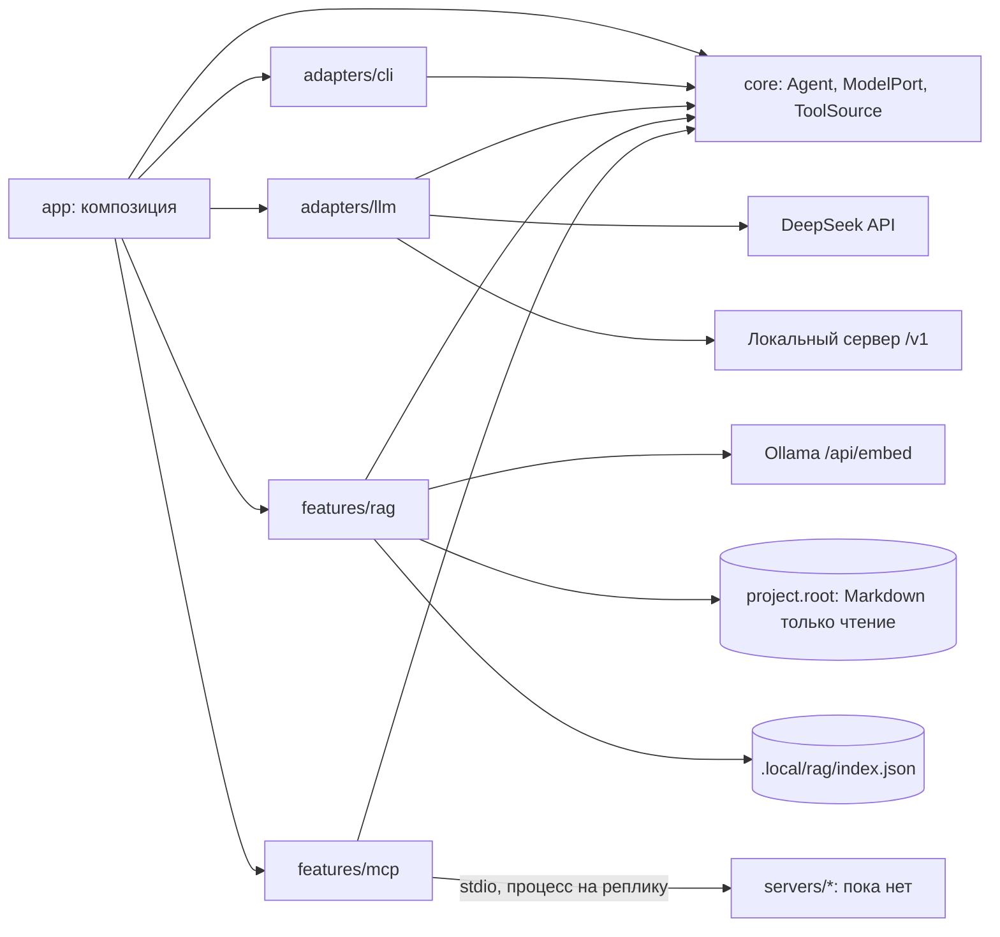

# Архитектура

## Текущее приложение

Исполняемый workspace `apps/host`; MCP-серверы появятся отдельными workspaces в `servers/`. Общих библиотек нет.
`app/main.ts` принимает окружение, argv и потоки; `app/compose.ts` собирает приложение. Модель (DeepSeek или локальная
по `llm.provider`) создаётся лениво при первом `ask` или `rag ask`, поэтому справка, настройки и `rag index` работают
без ключа.

CLI получает реестр обработчиков и потоки, не создаёт агента и не знает SDK. Вывод оформляет один CliView: обработчики
передают ему готовые строки, цвет решает `styleText` отдельно для stdout и stderr. Ход длинной операции (`rag index`) идёт
в stderr. Текст из REPL становится вызовом `ask`; `/команда` и подкоманда CLI используют один dispatch.

## Agent и цикл инструментов

Agent инкапсулирует ModelPort, системную инструкцию и лимит вызовов и не хранит состояния: `respond(input, { tools, history })`.
Сообщения собираются как system → история → вопрос. Если `tools` объявил инструменты, модель получает их с
`toolChoice: auto`, пока не исчерпан `maxToolCalls`; ответ с tool_calls проверяется целиком (непустой, в пределах
лимита, известные имена, аргументы-объекты) и исполняется по порядку — параллельные вызовы делили бы один stdio-транспорт.
ChatCompletionsModel переводит формат SDK и ошибки в AgentError, SDK-повторы отключены. В ядре нет SDK, файлов, env и
пользовательских текстов.

Понятия из курса ложатся на каркас так: инструмент (`name`, `description`, `parameters`) — `ToolDefinition` с
`inputSchema`; реестр и исполнитель — `ToolSource` и `combineToolSources`, которые направляют вызов по имени; ошибка
«unknown tool» — `AgentError UNKNOWN_TOOL_CALL` до исполнения.

## ask и MCP-сессии

`createAskHandler` (app/ask.ts) на каждую реплику создаёт модель, затем `withSessions` по очереди открывает сессии серверов
из `RunOptions.mcpServers` — вложенно, поэтому каждая закрывается в `finally` своей обёртки в обратном порядке. Источники
оборачиваются `observedToolSource` (строка `MCP: сервер › инструмент — выполнено/ошибка`) и объединяются
`combineToolSources`; одинаковые имена инструментов у двух серверов — ошибка. Без серверов `ask` отвечает без инструментов.

`withStdioToolSource` (features/mcp) запускает сервер, договаривается о современной ревизии протокола, проверяет
capability tools и адаптирует клиент к ToolSource; принимаются только текстовые блоки результата. Дочерний процесс
получает безопасный набор переменных SDK и объявленные `env`, но не окружение host.

## Песочница

Инструменты по умолчанию только читают. Правило держится на двух уровнях: сервер регистрирует только
читающие инструменты и не выходит за корень проекта из аргумента запуска; host не передаёт серверу ключи. Подтверждение
человека для опасной операции пока не реализовано: когда задание потребует такой инструмент, ADR определит место проверки
(app, до `callTool`) и вид подтверждения в CLI.

## Фича rag

`indexCorpus` выполняет шаги последовательно и заменяет индекс только после успеха всех запросов:

1. `loadCorpus` выбирает `.md` по `rag.include` внутри `project.root`, нормализует текст, отделяет frontmatter и разбирает
   блоки mdast.
2. `describeModel` и прогрев одним текстом дают digest, размерность и `load_duration`.
3. `buildChunks` режет документы по структуре, `embedAll` получает эмбеддинги пакетами по 8 текстов и проверяет ответ.
4. `writeIndex` пишет `index.json` через временный файл и `rename`.

`answerWithRag`: `openIndex` сверяет digest модели эмбеддингов → rewrite (по режиму) → поиск `rag.candidateTopK`
кандидатов линейным перебором по косинусной близости → отбор по порогу и `rag.topK` → генерация. При пустом отборе модель
не вызывается, код возвращает «не знаю». Ответ разбирается в `CitedAnswer` с проверкой цитат на дословность. `EmbeddingPort`
принадлежит фиче; адаптер Ollama лежит внутри неё. Подробности — README фичи.

## Границы и рост

Разрешённые импорты: app → core/adapters/features; adapters → core и публичные порты features; features → core.
Внешний вход фичи — index.ts. Фичи не импортируют друг друга даже через публичные входы.
Серверы — отдельные процессы с собственным composition root; host и серверы не импортируют друг друга.

Сейчас в core есть ModelPort и ToolSource. Контракты пайплайна, субагентов, хранилищ и трассировки заранее не
объявляются: когда задание потребует новый контракт, сначала принимается ADR с конкретным потребителем и проверяемой
границей. Не использовать общий mutable context или расширяемый объект с полями всех фич.
Правило записи: кандидат → save → замена. Временный файл и rename относятся к одному файлу.

## Настройки и документы

`app/settings.ts` — единственный реестр схем, defaults и признаков настроек; env и флаги вычисляются из ключей,
`app/settings.md` содержит описания. Порядок — default, YAML-файл, env, CLI; некорректный заданный источник
отклоняется, даже если перекрыт следующим. YAML использует плоские ключи с точками. `rag.include` во всех источниках —
строка шаблонов через запятую. Справка и docs/configuration.md, docs/commands.md генерируются из реестров.
Перекрёстные ограничения чанкинга проверяет `indexCorpus`, `rag.topK` ≤ `rag.candidateTopK` — `checkRetrievalParams`.

## Проверки

`npm run check`: Biome, TypeScript, dependency-cruiser (границы, циклы, публичные входы), размеры и структура,
актуальность генерируемых документов, тесты с coverage и сборка с запуском CLI из другого каталога.
Тесты без внешних API: fake ModelPort и EmbeddingPort, подменённые fetch, MCP SDK и сессии, временные каталоги.
